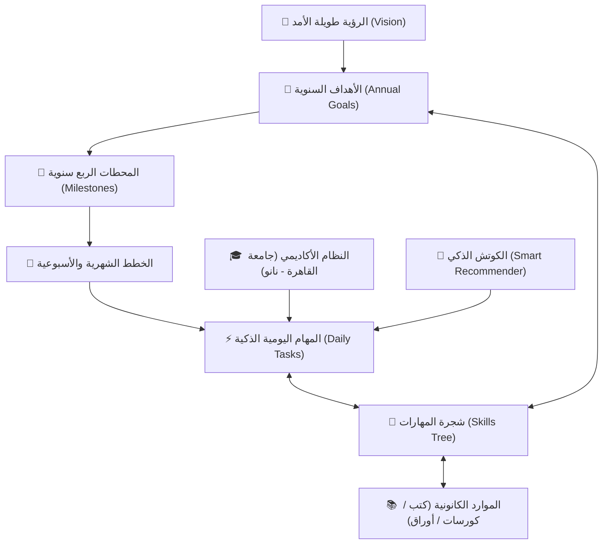

# مَسار | MASAAR — Personal Life Coach OS
> **نظام تشغيل وتوجيه الحياة الشخصي المتكامل (Local-First, Privacy-First, Connected Life Coach OS)**  
> مبني بإطار عمل **YVCF** (منهجية الـ 14 مرحلة) لتطوير المنتجات الرقمية فائقة الجودة.

---

## 🌟 نظرة عامة (Overview)

**مَسار (MASAAR)** ليس مجرد تطبيق لتسجيل المهام (To-Do List) أو مفكرة تقليدية، بل هو نظام تشغيل حياتي مترابط يربط الرؤية الاستراتيجية طويلة الأمد بالأهداف السنوية والمحطات الفصلية والخطوات الأسبوعية، وصولاً إلى المهام اليومية وقوائم المذاكرة الأكاديمية والعادات والقراءات الذرية.



---

## 🚀 المميزات الرئيسية (Core Capabilities)

### 1. 🎯 مركز الأهداف المتصل (Connected Goals Center)
- **4 آفاق زمنية متكاملة:** الرؤية العامة ← أهداف سنوية ← محطات ربع سنوية (Milestones) ← خطط شهرية.
- **حساب تقدم شفاف وقابل للتفسير (Explainable Progress):** لا توجد أرقام وهمية؛ التقدم يُحسب بدقة رياضية بناءً على نسبة المحطات والمهام المنجزة فعلياً.
- **ربط المهام والمهارات بالأهداف:** كل مهمة تقوم بها توضح مساهمتها المباشرة في تحقيق أهدافك الكبرى.

### 2. 🧠 مركز التعلم وشجرة المهارات (Unified Learning Center)
- **موارد كانونية غير مكررة (Canonical Resources):** الكتب، الكورسات، الفيديوهات، الأوراق البحثية، والمشاريع تُسجل ككيانات كانونية يمكن ربطها بأكثر من مهارة دون تكرار البيانات.
- **تصنيفات مخصصة مرنة (Custom Categories):** إنشاء تصنيفات وتصنيفات فرعية دون التقيد بقوائم ثابتة.
- **هيكلية كورسات نموذجية:** كورسات مرنة بوحدات (Modules) ودروس (Lessons) حقيقية، دون فرض أي أرقام عشوائية.
- **مقياسان للتقدم:** تتبع نسبة استهلاك المادة (Consumption %) ونسبة التمكن والخبرة (Mastery %).

### 3. 🎓 نظام المذاكرة الأكاديمي (Ahmed's University Study Planner)
- **مواد قسم تكنولوجيا النانو بجامعة القاهرة (8 مواد متكاملة):** تتبع دقيق للمحاضرات، الشيتات، الكويزات، والتسليمات.
- **دورة المذاكرة الثلاثية:** (جاهزية الماتريال ← المذاكرة ← المراجعة ← الحل والتطبيق) مع خوارزمية التكرار المتباعد `FSRS`.
- **الجدول الدراسي الأسبوعي:** توزيع المحاضرات على المدرجات (مدرج 5، مدرج ج، مدرج 7، مدرج 23، والأونلاين).
- **الأنشطة الطلابية:** متابعة مهام NASA Space Apps و Sciora.

### 4. 🤖 الكوتش الذكي والتدخل التأجيلي (Smart Today & Recommender)
- **ترشيح الأكشن الأفضل الآن (Best Next Action):** بناءً على أوزان حقيقية (أهمية الموعد، القرب من الامتحانات، المساهمة في الأهداف +30 نقطة، ومواقيت الصلاة).
- **تدخل التأجيل الذكي (3-Miss Adaptive Intervention):** عند تأجيل المهمة للمرة الثالثة، يتدخل الكوتش بمقترح عملي لتفكيكها أو إعادة برمجتها بدلاً من رميها تلقائياً لليوم التالي.

### 5. 🛡️ الأمان، الخصوصية، والنسخ الاحتياطي (Security & Privacy)
- **Local-First & Offline-First:** التطبيق يعمل بنسبة 100% دون إنترنت باستخدام `Dexie.js` (IndexedDB).
- **حماية RLS صارمة:** قواعد Supabase RLS محصنة بالكامل ضد الوصول غير المصرح به (`TO authenticated` مع استعلامات ملكية صارمة).
- **محرك نسخ احتياطي لـ 26 جدولاً:** تصدير واسترجاع ذري لكافة الجداول والروابط والعلاقات بضغطة زر.
- **قراءة ذرية مع حماية الـ XP:** منع استغلال النقاط أو القراءة بعد انتهاء صفحات الكتاب.

### 6. 📱 تجربة مستخدم متجاوبة (Responsive Mobile & Desktop)
- **موبايل مريح للإبهام:** شريط تنقل سفلي سريع (`اليوم | الأهداف | الجامعة | التعلم | المزيد`).
- **شاشات التابلت والديسكتوب:** هيدر علوي متجاوب ومساحات عرض واسعة بدون تقييد بـ `max-w-md`.
- **تصميم عصري:** لغة تصميم 2026 تمزج بين الـ Glassmorphism و النيومورفيزم والتدرجات النابضة واحتفالات الإنجاز (Confetti).

---

## 🛠️ البنية التقنية (Tech Stack)

| الطبقة | التقنية المستخدمة |
| :--- | :--- |
| **الواجهة الأمامية** | React 19 + TypeScript + Vite |
| **التصميم والواجهة** | Tailwind CSS + Lucide Icons + Canvas Confetti |
| **قاعدة البيانات المحلية** | Dexie.js (IndexedDB v3 Schema - 26 Stores) |
| **التطبيق المتقدم (PWA)** | Vite PWA Plugin + Service Worker (Workbox) |
| **السحابة والمزامنة** | Supabase (PostgreSQL + Hardened Row Level Security) |
| **التوقيت والفلك** | Adhan Library + Cairo Timezone Engine (`dateUtils.ts`) |
| **الاختبارات** | Vitest + Fake IndexedDB + 21 Unit & Integration Tests |

---

## 📦 التثبيت والتشغيل المحلي (Quick Start)

### 1. استنساخ المستودع (Clone)
```bash
git clone https://github.com/AhmedHakim22/My-life.git
cd My-life
```

### 2. تثبيت الحزم (Install Dependencies)
```bash
npm install
```

### 3. تشغيل بيئة التطوير (Run Dev Server)
```bash
npm run dev
```
افتح المتصفح على: `http://localhost:5173/`

### 4. تشغيل الاختبارات الآلية (Run Tests)
```bash
npm test
```
تشغيل الـ 21 اختباراً المدمجة للتحقق من سلامة الأهداف والنسخ الاحتياطي والقراءة الذرية.

### 5. بناء نسخة الإنتاج (Production Build)
```bash
npm run build
```
توليد مجلد `dist/` مع ملفات الـ PWA والـ Service Worker الجاهزة للاستضافة المباشرة.

---

## 🧪 نتائج الاختبارات الموثقة (Test Verification)

```text
✓ src/engines/__tests__/date-utils.test.ts (3 tests)
✓ src/engines/__tests__/engines.test.ts (12 tests)
✓ src/engines/__tests__/backup-roundtrip.test.ts (1 test)
✓ src/engines/__tests__/atomic-read.test.ts (2 tests)
✓ src/engines/__tests__/goal-engine.test.ts (2 tests)
✓ src/engines/__tests__/mandatory-demo-proof.test.ts (1 test)

Test Files  6 passed (6)
Tests       21 passed (21)
Duration    ~650ms
```

---

## 📄 التوثيق المعماري وسجلات القرارات
- [`docs/PROJECT_STATE.md`](file:///docs/PROJECT_STATE.md): حالة المشروع الحالية بالتفصيل.
- [`docs/FEATURE_REGISTRY.md`](file:///docs/FEATURE_REGISTRY.md): سجل الميزات والحالات الواقعية.
- [`docs/CHANGELOG.md`](file:///docs/CHANGELOG.md): سجل التحديثات المؤرخة.
- [`docs/06-PRD.md`](file:///docs/06-PRD.md): وثيقة متطلبات المنتج الكاملة.
- [`supabase/schema.sql`](file:///supabase/schema.sql): مخطط قاعدة البيانات السحابية وسياسات الأمان.
- [`supabase/migrations/`](file:///supabase/migrations/): ملفات التهجير والتراجع للـ RLS.

---
**صُنع بحب وإتقان ليكون مساراً حقيقياً نحو التميز العلمي والعملي.** 🚀
