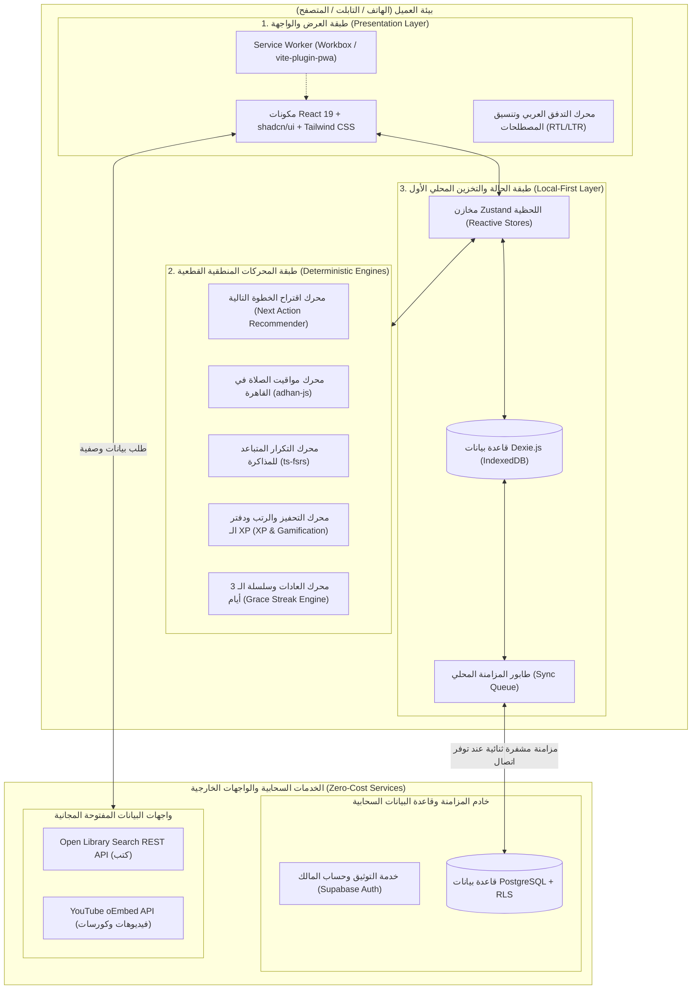

# YVCF Stage 7 — Technical Architecture & System Design
**اسم المنتج:** مَسار (MASAAR Life OS)  
**الإصدار المعماري:** 1.0  
**تاريخ التوثيق:** 21 أكتوبر 2026  
**النمط المعماري:** Local-First PWA with Modular Domain Engines & Cloud Sync

---

## 1. المخطط المعماري العام للنظام (System Architecture Overview)

---

## 2. تفصيل الطبقات المعمارية (Architectural Layers Breakdown)

### أ. طبقة العرض والواجهة (Presentation & Mobile-First PWA)
- **الإطار:** React 19 مع Vite 6 لضمان أسرع وقت استجابة وتحزيم فائق الخفة.
- **التصميم:** Tailwind CSS v4 مع مكونات Radix UI (عبر shadcn/ui)، مخصصة بالكامل لاتجاه اليمين إلى اليسار (RTL) واستخدام إبهام اليد (Thumb-Friendly Controls).
- **الـ PWA والتخزين المسبق (Service Worker):** حزمة `vite-plugin-pwa` مع استراتيجية `CacheFirst` للأصول والخطوط، و `NetworkFirst` أو `StaleWhileRevalidate` لطلبات البيانات، مما يضمن فتح التطبيق في 300 ملي ثانية بدون شبكة.

### ب. طبقة المحركات القطعية (Deterministic Domain Engines)
تم فصل منطق الأعمال في دوال ومحركات معيارية نقية (Pure Functions) يسهل اختبارها وعزلها:
1. **محرك الصلاة (`prayer-times.ts`):** يستدعي `adhan-js` مع إحداثيات القاهرة (`30.0444, 31.2357`) وزوايا الهيئة العامة للمساحة المصرية.
2. **محرك المذاكرة التكيفية (`study-engine.ts`):** يطبق خوارزمية `ts-fsrs` لتقييم درجات الاستيعاب وتحديد مواعيد المراجعة الفاصلة قبل موعد الامتحان الفعلي.
3. **محرك شاشة اليوم (`recommendation-engine.ts`):** خوارزمية قطعية ذات أوزان شفافة:
   `Score = (Exam_Proximity * 0.35) + (Long_Term_Impact * 0.35) + (Time_Window_Fit * 0.2) + (Postponement_Penalty * 0.1)`.
4. **محرك العادات والـ Streaks (`habit-engine.ts`):** يحسب الأيام المؤهلة فقط، ويتجاهل أيام الراحة المجدولة، ولا يصفر العداد إلا بعد 3 أيام متتالية من الفوات.
5. **محرك التحفيز ورتبة أستاذ علوم (`gamification-engine.ts`):** دفتر أستاذ غير قابل للتكرار (Idempotent Ledger) وقفل زمني لا يسمح برتبة Professor of Science إلا بعد 180 يوماً فعلياً.

### ج. طبقة التخزين المحلي الأول والمزامنة (Local-First Persistence & Sync)
- **القاعدة المحلية:** Dexie.js (مغلف خفيف وسريع لـ IndexedDB في المتصفح). كل قراءة وكتابة تتم محلياً أولاً (Zero Latency).
- **طابور المزامنة (Sync Queue):** أي تعديل محلي يُنشئ سجلاً في طابور التغييرات مع طابع زمني دقيق (`updated_at`) ومعرف فريد (UUID v4).
- **محرك المزامنة (Sync Engine):**
  - يعمل في الخلفية بمجرد توفر اتصال بالإنترنت.
  - يرسل التغييرات عبر `@supabase/supabase-js`.
  - يطبق استراتيجية دمج تعتمد على الحقول الأحدث (Field-level Last-Write-Wins)، مع تنبيه المستخدم يدوياً في حال تضارب نصوص اليوميات، وحظر المسح الصامت للبيانات.

### د. طبقة السحابة والأمان (Cloud & Security Layer)
- **قاعدة البيانات:** PostgreSQL مدارة مجاناً عبر Supabase.
- **أمان عزل البيانات (Row Level Security - RLS):** مفعل إجبارياً على جميع الجداول، بحيث لا يستطيع أي مستخدم الوصول إلا للسجلات التي تحمل `user_id = auth.uid()`.
- **المفاتيح:** مفتاح الواجهة الأمامية هو `anon_key` العام المقيد بـ RLS، ولا توجد أي مفاتيح سرية في كود المتصفح.

---

## 3. الحدود المعمارية وعقود الواجهات (Boundary Contracts)
- **لا اتصال مباشر بين واجهة المستخدم وقاعدة البيانات السحابية:** كل تفاعل يمر حصرياً عبر مخازن Zustand المحلية وقاعدة IndexedDB لضمان استمرارية العمل بدون إنترنت.
- **الرسم البياني الموحد (Canonical Entity Authority):** يوجد سجل كنسي واحد لكل مورد (كتاب، كورس، فيديو)، وترتبط به المهارات والأهداف عبر جداول وصل (Join Tables)، وتحديث موضع القراءة يتم في جلسة قراءة واحدة تنعكس على باقي السجلات.
- **حظر نقل اليوميات:** عزل كامل لوحدة اليوميات والملاحظات لمنع أي تسريب لطرف خارجي.
