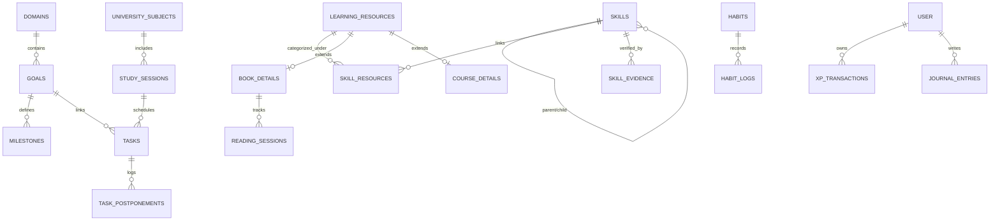

# Data Model Specification — Personal Learning Graph
**اسم المنتج:** مَسار (MASAAR Life OS)  
**الإصدار:** 1.0  
**تاريخ التوثيق:** 21 أكتوبر 2026  
**محرك التخزين:** PostgreSQL (سحابياً عبر Supabase) و IndexedDB (محلياً عبر Dexie.js)

---

## 1. مخطط الكيانات والعلاقات (Entity Relationship Diagram)

---

## 2. تفصيل جداول وقواعد البيانات (Schema Tables DDL)

### 1. جدول مجالات الحياة (`domains`)
- `id` (UUID, Primary Key)
- `user_id` (UUID, Not Null, FK -> `auth.users`)
- `name` (TEXT, Not Null, e.g. "جامعة القاهرة / نانو", "فالكون", "القراءة")
- `icon` (TEXT, e.g. "atom", "briefcase", "book")
- `color` (TEXT, HEX)
- `sort_order` (INTEGER, Default 0)
- `is_archived` (BOOLEAN, Default FALSE)
- `created_at` / `updated_at` (TIMESTAMPTZ)

### 2. جدول الأهداف الكبرى (`goals`)
- `id` (UUID, Primary Key)
- `user_id` (UUID, FK -> `auth.users`)
- `domain_id` (UUID, FK -> `domains.id` ON DELETE SET NULL)
- `title` (TEXT, Not Null)
- `why_it_matters` (TEXT, مبرر الأهمية)
- `horizon` (TEXT, ENUM: `LONG_TERM`, `ANNUAL`, `QUARTERLY`, `MONTHLY`)
- `target_date` (DATE)
- `status` (TEXT, ENUM: `NOT_STARTED`, `IN_PROGRESS`, `ACHIEVED`, `PAUSED`, `ARCHIVED`)
- `progress_percentage` (INTEGER, Default 0)
- `is_archived` (BOOLEAN, Default FALSE)
- `created_at` / `updated_at` (TIMESTAMPTZ)

### 3. جدول المهارات وشجرة المهارات (`skills`)
- `id` (UUID, Primary Key)
- `user_id` (UUID, FK -> `auth.users`)
- `parent_skill_id` (UUID, Nullable, FK -> `skills.id` ON DELETE SET NULL)
- `name` (TEXT, Not Null, e.g. "Python", "Semiconductor Physics")
- `category` (TEXT, e.g. "تقني", "علمي", "بزنس", "مهارات ناعمة")
- `baseline_level` (INTEGER, Default 1)
- `target_level` (INTEGER, Default 5)
- `content_progress` (INTEGER, 0-100, نسبة استهلاك الكورسات والمصادر)
- `demonstrated_competence` (INTEGER, 0-100, نسبة الإتقان المثبتة بمشاريع)
- `sort_order` (INTEGER, Default 0)
- `created_at` / `updated_at` (TIMESTAMPTZ)

### 4. جدول الموارد التعليمية الموحد (`learning_resources`)
*السجل الكنسي الموحد لكل مادة تعليمية (كتاب، كورس، فيديو، مقال، ورقة بحثية).*
- `id` (UUID, Primary Key)
- `user_id` (UUID, FK -> `auth.users`)
- `type` (TEXT, ENUM: `BOOK`, `COURSE`, `VIDEO`, `PLAYLIST`, `PAPER`, `PROJECT`, `CUSTOM`)
- `title` (TEXT, Not Null)
- `description` (TEXT)
- `source_url` (TEXT)
- `provider` (TEXT, e.g. "YouTube", "Coursera", "Paper", "Library")
- `status` (TEXT, ENUM: `PLANNED`, `IN_PROGRESS`, `COMPLETED`, `PAUSED`, `DROPPED`)
- `created_at` / `updated_at` (TIMESTAMPTZ)

### 5. تفاصيل الكتب (`book_details`)
*جدول علائقي يمتد من `learning_resources` عند كون النوع `BOOK`.*
- `resource_id` (UUID, Primary Key, FK -> `learning_resources.id` ON DELETE CASCADE)
- `author` (TEXT)
- `isbn` (TEXT)
- `cover_url` (TEXT)
- `total_pages` (INTEGER, Default 0)
- `current_page` (INTEGER, Default 0)
- `shelf` (TEXT, Default "Want to Read")
- `rating` (INTEGER, 1-5, Nullable)

### 6. جلسات القراءة السريعة (`reading_sessions`)
- `id` (UUID, Primary Key)
- `user_id` (UUID, FK -> `auth.users`)
- `book_resource_id` (UUID, FK -> `learning_resources.id` ON DELETE CASCADE)
- `pages_read` (INTEGER, Not Null, e.g. 2)
- `start_page` / `end_page` (INTEGER)
- `date` (DATE, Not Null)
- `notes` (TEXT)
- `created_at` (TIMESTAMPTZ)

### 7. تفاصيل الكورسات والفيديوهات (`course_details`)
- `resource_id` (UUID, Primary Key, FK -> `learning_resources.id` ON DELETE CASCADE)
- `instructor` (TEXT)
- `total_lessons` (INTEGER, Default 0)
- `completed_lessons` (INTEGER, Default 0)
- `duration_minutes` (INTEGER, Default 0)
- `thumbnail_url` (TEXT)

### 8. جدول الربط بين المهارات والموارد (`skill_resources`)
- `skill_id` (UUID, FK -> `skills.id` ON DELETE CASCADE)
- `resource_id` (UUID, FK -> `learning_resources.id` ON DELETE CASCADE)
- `PRIMARY KEY (skill_id, resource_id)`

### 9. شواهد كفاءة المهارة (`skill_evidence`)
- `id` (UUID, Primary Key)
- `skill_id` (UUID, FK -> `skills.id` ON DELETE CASCADE)
- `title` (TEXT, Not Null, e.g. "كود محاكاة بلورة النانو على غيت هب")
- `url` (TEXT)
- `verification_date` (DATE)
- `notes` (TEXT)

### 10. جدول المقررات الجامعية (`university_subjects`)
- `id` (UUID, Primary Key)
- `user_id` (UUID, FK -> `auth.users`)
- `name` (TEXT, Not Null, e.g. "أشباه الموصلات وتطبيقات النانو")
- `code` (TEXT, e.g. "NANO-301")
- `academic_year` (INTEGER, e.g. 3)
- `semester` (INTEGER, 1 or 2)
- `professor` (TEXT)
- `exam_date` (DATE, Nullable)
- `difficulty` (TEXT, ENUM: `EASY`, `MEDIUM`, `HARD`)
- `created_at` / `updated_at` (TIMESTAMPTZ)

### 11. جلسات ومحاضرات المادة (`study_sessions`)
- `id` (UUID, Primary Key)
- `subject_id` (UUID, FK -> `university_subjects.id` ON DELETE CASCADE)
- `type` (TEXT, ENUM: `LECTURE`, `LAB`, `TUTORIAL`, `ASSIGNMENT`, `EXAM_PREP`)
- `title` (TEXT, Not Null, e.g. "محاضرة 4: Band Gap Engineering")
- `status` (TEXT, ENUM: `STUDIED`, `UNDERSTOOD`, `REVISED`, `SOLVED`, `COMPLETED`, `SUBMITTED`)
- `submitted_date` (TIMESTAMPTZ, Nullable)
- `fsrs_stability` (DOUBLE PRECISION, Default 0.0)
- `fsrs_difficulty` (DOUBLE PRECISION, Default 0.0)
- `fsrs_last_review` (TIMESTAMPTZ, Nullable)
- `fsrs_next_review` (TIMESTAMPTZ, Nullable)

### 12. جدول المهام الذكية (`tasks`)
- `id` (UUID, Primary Key)
- `user_id` (UUID, FK -> `auth.users`)
- `title` (TEXT, Not Null)
- `priority` (TEXT, ENUM: `P1_URGENT_IMPORTANT`, `P2_IMPORTANT`, `P3_NORMAL`)
- `status` (TEXT, ENUM: `TODO`, `IN_PROGRESS`, `DONE`, `POSTPONED`, `CANCELLED`)
- `due_date` (DATE, Nullable)
- `estimated_minutes` (INTEGER, Default 30)
- `is_locked` (BOOLEAN, Default FALSE, المواعيد الثابتة لا يتم ترحيلها تلقائياً)
- `postponement_count` (INTEGER, Default 0)
- `goal_id` (UUID, Nullable, FK -> `goals.id` ON DELETE SET NULL)
- `skill_id` (UUID, Nullable, FK -> `skills.id` ON DELETE SET NULL)
- `study_session_id` (UUID, Nullable, FK -> `study_sessions.id` ON DELETE SET NULL)
- `created_at` / `updated_at` (TIMESTAMPTZ)

### 13. سجل تأجيل المهام (`task_postponements`)
- `id` (UUID, Primary Key)
- `task_id` (UUID, FK -> `tasks.id` ON DELETE CASCADE)
- `postponed_at` (TIMESTAMPTZ)
- `reason` (TEXT, اختياري: "ضيق وقت", "صعوبة", "ظرف طارئ", "عدم رغبة")
- `new_due_date` (DATE)

### 14. جدول العادات وسلسلة الـ 3 أيام (`habits`)
- `id` (UUID, Primary Key)
- `user_id` (UUID, FK -> `auth.users`)
- `title` (TEXT, Not Null, e.g. "قراءة صفحتين يومياً", "الورد القرآني")
- `target_type` (TEXT, ENUM: `BOOLEAN`, `PAGES`, `MINUTES`)
- `target_value` (INTEGER, Default 1)
- `streak_count` (INTEGER, Default 0)
- `consecutive_misses` (INTEGER, Default 0, تصفير الـ Streak عند وصوله لـ 3)
- `rest_days` (INTEGER[], مصفوفة أيام الراحة كأرقام 0-6، مثلاً [5] للجمعة)
- `last_completed_date` (DATE, Nullable)
- `created_at` / `updated_at` (TIMESTAMPTZ)

### 15. سجل العادات اليومي (`habit_logs`)
- `id` (UUID, Primary Key)
- `habit_id` (UUID, FK -> `habits.id` ON DELETE CASCADE)
- `date` (DATE, Not Null)
- `status` (TEXT, ENUM: `COMPLETED`, `REST_DAY`, `SKIPPED`, `MISSED`)
- `value_recorded` (INTEGER, Default 1)
- `trigger_source` (TEXT, e.g. `MANUAL_TAP`, `READING_2_PAGES_ACTION`)
- `UNIQUE (habit_id, date)`

### 16. دفتر أستاذ نقاط الخبرة غير القابل للتكرار (`xp_transactions`)
- `id` (UUID, Primary Key)
- `user_id` (UUID, FK -> `auth.users`)
- `idempotency_key` (TEXT, Unique, Not Null, e.g. `sha256("READING_2_PAGES:" + book_id + ":" + date)`)
- `amount` (INTEGER, Not Null, e.g. +15, +50)
- `category` (TEXT, ENUM: `STUDY`, `READING`, `HABIT`, `SKILL_PROJECT`, `MILESTONE`)
- `reason` (TEXT)
- `created_at` (TIMESTAMPTZ, Default NOW())

### 17. جدول اليوميات والملاحظات السريعة (`journal_entries`)
- `id` (UUID, Primary Key)
- `user_id` (UUID, FK -> `auth.users`)
- `date` (DATE, Not Null)
- `mode` (TEXT, ENUM: `FREE_WRITING`, `GUIDED_5_PROMPTS`)
- `content` (TEXT, مشفر محلياً وسحابياً)
- `tags` (TEXT[], e.g. `["#فالكون", "#نانو", "#تأمل"]`)
- `created_at` / `updated_at` (TIMESTAMPTZ)

### 18. طابور المزامنة المحلي (`sync_queue` - محلي فقط في IndexedDB)
- `id` (Auto-increment)
- `table_name` (TEXT)
- `record_id` (UUID)
- `operation` (TEXT, ENUM: `INSERT`, `UPDATE`, `DELETE`)
- `payload` (JSON)
- `created_at` (INTEGER timestamp)
- `retry_count` (INTEGER, Default 0)
