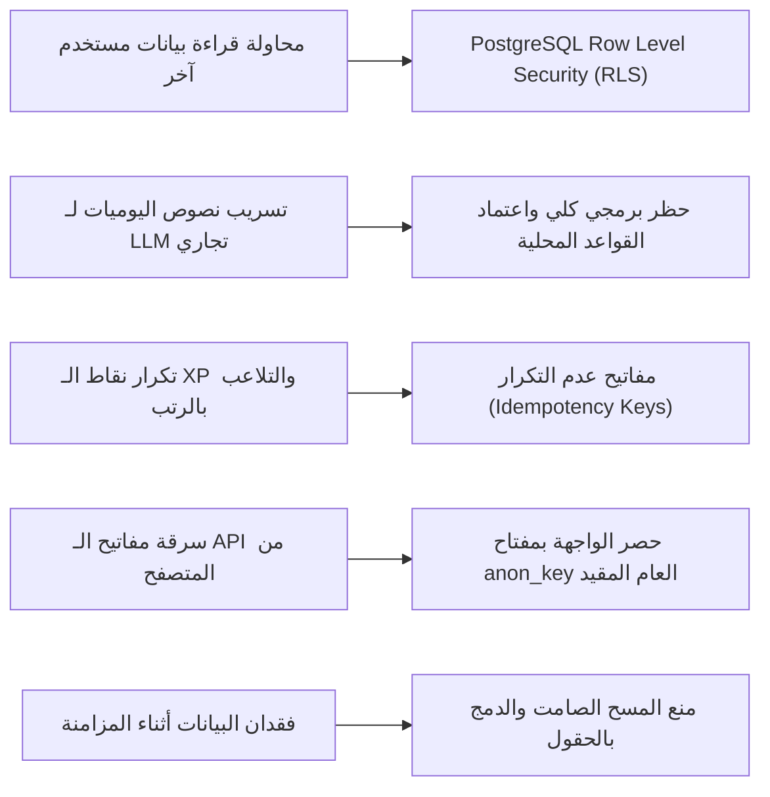

# Security Architecture & Privacy-by-Design Specification
**اسم المنتج:** مَسار (MASAAR Life OS)  
**الإصدار:** 1.0  
**تاريخ التوثيق:** 21 أكتوبر 2026  
**المرجعية:** OWASP Top 10 for Jamstack & Mobile Web Applications

---

## 1. نموذج التهديدات وتحصين الخصوصية (Threat Model & Mitigations)



---

## 2. سياسات أمان مستوى الصفوف (Row Level Security - RLS Policies)

يتم تفعيل الـ RLS على كل جدول دون استثناء في قاعدة بيانات PostgreSQL:

```sql
-- مثال لتطبيق RLS على جدول اليوميات والملاحظات
ALTER TABLE journal_entries ENABLE ROW LEVEL SECURITY;

-- السماح للمستخدم فقط بقراءة وكتابة وتعديل سجلاته الخاصة
CREATE POLICY "Users can only access their own journal entries"
ON journal_entries
FOR ALL
USING (auth.uid() = user_id)
WITH CHECK (auth.uid() = user_id);

-- تطبيق نفس السياسة على المهام والمقررات والكتب والأهداف
ALTER TABLE tasks ENABLE ROW LEVEL SECURITY;
CREATE POLICY "Tasks tenant isolation" ON tasks FOR ALL
USING (auth.uid() = user_id) WITH CHECK (auth.uid() = user_id);

ALTER TABLE university_subjects ENABLE ROW LEVEL SECURITY;
CREATE POLICY "University tenant isolation" ON university_subjects FOR ALL
USING (auth.uid() = user_id) WITH CHECK (auth.uid() = user_id);

ALTER TABLE learning_resources ENABLE ROW LEVEL SECURITY;
CREATE POLICY "Resources tenant isolation" ON learning_resources FOR ALL
USING (auth.uid() = user_id) WITH CHECK (auth.uid() = user_id);

ALTER TABLE xp_transactions ENABLE ROW LEVEL SECURITY;
CREATE POLICY "XP ledger tenant isolation" ON xp_transactions FOR ALL
USING (auth.uid() = user_id) WITH CHECK (auth.uid() = user_id);
```

---

## 3. تشفير اليوميات الحساسة محلياً (Client-Side Encryption for Journals)
- توفير خيار تشفير نصوص اليوميات الحساسة محلياً باستخدام **Web Crypto API (AES-256-GCM)** قبل تخزينها في IndexedDB أو رفعها لسحابة Supabase.
- المفتاح مشتق محلياً عبر PBKDF2 من كلمة مرور يحددها المستخدم ولا تُرسل للسيرفر إطلاقاً.
- يضمن هذا أنه حتى لو فُتحت قاعدة البيانات السحابية مباشرة، تظل نصوص اليوميات مشفرة وغير مقروءة لأي شخص سوى مالك الجهاز.

---

## 4. سياسة التعامل مع الذكاء الاصطناعي (Strict Zero-Leakage AI Policy)
1. **الافتراضي الدائم (Default State):** لا يتم إرسال أي حرف من بيانات المستخدم (أهداف، مهام، مذكرات، كتب، صلوات) إلى أي نموذج ذكاء اصطناعي خارجي (مثل OpenAI أو Google أو Anthropic).
2. **محرك الصباح قطعي محلي:** خوارزمية اقتراح "أفضل خطوة تالية" مبنية على معادلات رياضية نقية تنفذ داخل متصفح المستخدم دون أي استدعاء خارجي.
3. **أي ميزة ذكاء اصطناعي مستقبلية تتطلب:**
   - شاشة موافقة صريحة توضح بدقة ما سيتم إرساله.
   - خيار استخدام مفتاح المستخدم الشخصي (BYOK - Bring Your Own Key) إذا رغب في ذلك مستقبلاً دون إجبار.
