# Synchronization & Offline-First Strategy
**اسم المنتج:** مَسار (MASAAR Life OS)  
**الإصدار:** 1.0  
**تاريخ التوثيق:** 21 أكتوبر 2026  
**النمط:** Local-First Architecture with Asynchronous Bidirectional Cloud Sync

---

## 1. فلسفة المعمارية غير المتصلة (Local-First Core Philosophy)
- **قاعدة الصفر تأخير (Zero Latency UI):** لا ينتظر المستخدم أبداً استجابة السحابة لإضافة مهمة أو تسجيل صفحتين أو تدوين فكرة سريعة. كل عملية كتابة تُحفظ فوراً وبشكل متزامن في قاعدة بيانات IndexedDB المحلية للمتصفح.
- **التشغيل المستقل بدون إنترنت (100% Offline Capability):** التطبيق يعمل بكامل وظائفه الحسابية والتنظيمية في المترو، أو في المعمل، أو في حالة انقطاع الشبكة في مصر.
- **المزامنة الانتهازية الصامتة (Opportunistic Background Sync):** عند توفر اتصال بالإنترنت، يفرغ طابور المزامنة المحلي دفعة واحدة إلى خادم Supabase PostgreSQL في الخلفية دون أي تجميد للواجهة.

---

## 2. مخطط تدفق المزامنة (Sync Workflow Diagram)

```mermaid
sequenceDiagram
    autonumber
    actor User as المستخدم (الهاتف)
    participant UI as واجهة التطبيق (React 19)
    participant IDB as التخزين المحلي (Dexie.js)
    participant Queue as طابور المزامنة (Sync Queue)
    participant Sync as محرك المزامنة (Sync Engine)
    participant Cloud as سحابة Supabase (Postgres RLS)

    User->>UI: إنجاز "قرأت صفحتين" (Tap)
    UI->>IDB: كتابة ذرية في IndexedDB (تحديث الكتاب + العادة + الـ XP)
    IDB-->>UI: تأكيد فوري وتحديث الشاشة (خلال 5ms)
    IDB->>Queue: إضافة 3 عمليات في طابور التغييرات مع UUIDs و updated_at
    
    rect rgb(20, 30, 50)
        Note over Sync,Cloud: عند توفر اتصال بالإنترنت (Network Online Event)
        Sync->>Queue: قراءة العمليات المعلقة (Pending Mutations)
        Sync->>Cloud: إرسال العمليات في دفعة واحدة (Batch Upsert)
        Cloud-->>Sync: تأكيد النجاح مع الطوابع الزمنية للسيرفر
        Sync->>Queue: حذف العمليات المكتملة من الطابور
        Sync->>Cloud: الاستعلام عن أي تعديلات حدثت من جهاز آخر (Delta Pull)
        Cloud-->>Sync: السجلات المحدثة منذ آخر مزامنة
        Sync->>IDB: دمج التعديلات في IndexedDB دون مسح العمليات الأحدث
    end
```

---

## 3. قواعد فض النزاعات ومنع فقدان البيانات (Conflict Resolution Rules)

| نوع البيانات | سيناريو التعارض المحتمل | قاعدة فض النزاع المعتمدة | السلوك البرمجي لضمان الأمان |
| :--- | :--- | :--- | :--- |
| **سجل نقاط الـ XP** | تكرار إرسال طلب الشبكة أو إعادة تشغيل التطبيق. | **Idempotent Ledger** | كل معاملة تحمل `idempotency_key = sha256(...)`؛ يقبل السيرفر المعاملة أول مرة ويرفض التكرار بصمت دون خطأ. |
| **المهام والأهداف والمقررات** | تعديل حالة المهمة على الهاتف (أوفلاين) وتعديلها على التابلت (أوفلاين) في نفس الوقت. | **Field-Level Last-Write-Wins (LWW)** | مقارنة الطابع الزمني `updated_at`؛ التعديل الأحدث يكتب فوق الأقدم على مستوى الحقل، ولا يتم مسح الكيان بالكامل. |
| **موضع قراءة الكتاب (الصفحات)** | قراءة صفحتين على الهاتف ثم قراءة 4 صفحات على التابلت. | **Monotonic Max Value** | موضع القراءة الجديد هو `max(local_page, remote_page)`؛ لا يمكن لموضع القراءة أن يرجع للوراء إلا بطلب صريح من المستخدم. |
| **سلسلة العادات (Streaks)** | تسجيل العادة على جهازين مختلفين في نفس اليوم. | **Atomic Set** | تسجيل اليوم هو قيمة ثنائية لنفس التاريخ (`date`)؛ لا يؤدي لتسجيل مرتين. |
| **نصوص اليوميات والملاحظات الحرة** | تعديل نص نفس اليومية على الهاتف والتابلت في وقت واحد بتعديلات مختلفة. | **Manual Conflict Fork (منع المسح الصامت)** | في حال تباين النصين في نفس اليومية بفارق زمني متقارب، يقوم النظام بحفظ النص الأحدث ويضع النص الآخر في بطاقة "مسودة غير مدمجة" مع تنبيه المستخدم ليختار بيده دون مسح أي فكرة كتبها. |

---

## 4. استراتيجية النسخ الاحتياطي اليدوي (One-Click JSON/CSV Export & Restore)
- للمستخدم الحق المطلق في ملكية بياناته الكاملة دون الارتهان لأي خادم.
- زر مخصص في الإعدادات: **"تنزيل نسخة احتياطية كاملة (JSON)"**:
  - يجمع كل سجلات IndexedDB في ملف JSON واحد مضغوط يحمل تاريخ اليوم.
- زر **"استعادة نسخة احتياطية"**:
  - يقرأ ملف الـ JSON، يتحقق من سلامة المخطط (Schema Validation via Zod)، ثم يستبدل أو يدمج السجلات محلياً ويزامنها مع السحابة.
