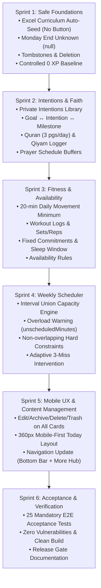

# MASAAR V2 — Master Upgrade Plan
**Project:** MASAAR / مَسار (Personal Life Coach OS V2)  
**Methodology:** YVCF 14-Stage Product Development Framework (Upgrade Mode)  
**Architecture:** Local-First, Privacy-First, Mobile-First PWA (React 19 + TypeScript + Dexie v4 + Supabase Hardened RLS)

---

## 1. Roadmap & Sprint Breakdown



---

## 2. Sprint Details & Scope

### Sprint 1: Safe Foundations & Honest Baseline (Immediate Execution)
- **1.1 Automatic Academic Curriculum Seeding:**
  - Create `src/db/ahmedCurriculum.ts` strictly matching `Ahmed_Study_Planner_Simple_Smart_v4.xlsx` (8 subjects: Thermodynamics, Quantum I, Nanomaterials Water Treatment, Management & Econ, Solid State, CS, Molecular Spectroscopy, Nanotech in Biomedicine; 8 slots).
  - Add Dexie v4 schema with `appMeta` table for migration markers (`curriculum-2026-semester1-excel-v2`).
  - Wire `seedAhmedStudyPlannerIfNeeded()` into `loadAllData()` so it executes automatically on startup without any UI button.
  - Reset untouched seeded exam dates to undefined; preserve user modifications.
  - Mark Monday Molecular Spectroscopy `endTime: null` and display `وقت الانتهاء غير محدد`.
  - Add `ALTER TABLE public.timetable_slots ALTER COLUMN end_time DROP NOT NULL;` in Supabase migration.
- **1.2 Deletion Tombstone & Universal Delete Architecture:**
  - Add `tombstones` table to Dexie (`entityType`, `entityId`, `deletedAt`).
  - Implement soft delete and tombstone recording so deleted items are NEVER resurrected by re-seeds or cloud sync.
  - Implement full book deletion and resource unlinking.
- **1.3 Controlled 0 XP Baseline Reset:**
  - Implement restorable pre-reset backup function (`createPreResetBackup`).
  - Archive or clear legacy XP transactions, setting `currentXP` to genuine 0 XP.
  - Record versioned reset event (`xpResetEvents`).
  - Stop for explicit user approval before triggering the destructive reset!

### Sprint 2: Connected Goals, Intentions & Private Faith Workspace
- **2.1 Intentions Center:**
  - New entities: `intentions`, `goalIntentions`.
  - Private intention creation, editing, archiving, and linking to goals.
  - Surface "Why am I doing this?" respectfully in goal details and tasks.
- **2.2 Faith Workspace (`FaithWorkspace.tsx`):**
  - 5 daily prayer times with customizable pre/post buffers (e.g. 15 min before, 15 min after).
  - Quran reading tracker: default target **3 pages/day** (owner editable), actual page input, streak, and weekly stats.
  - Qiyam al-Layl tracking: session logger with duration, rak'ahs, notes, and seamless midnight-crossing support (e.g. 23:30 to 00:20).
  - Strictly private by default, zero AI export, and zero XP scoring.

### Sprint 3: Health & Fitness + Availability Modeling
- **3.1 Health & Fitness Workspace (`FitnessWorkspace.tsx`):**
  - Personal daily movement minimum: **20 minutes** (editable).
  - Log activity types: gym/strength, walking, cycling, running, mobility, stretching, sport, custom.
  - Structured workout logging: optional sets, reps, and weights.
  - Weekly progress visualization vs 20-min daily target (140 min/week) and distinct WHO 150-min benchmark.
  - Rest/recovery days honored without punishment.
- **3.2 Availability Rules & Fixed Commitments:**
  - Model sleep windows (e.g. 23:00 - 06:30), meal times, commutes, Falcon work budgets, and university class blocks.

### Sprint 4: Weekly Scheduling Engine (Constraint-Based)
- **4.1 Engine Algorithm (`src/engines/scheduler.ts`):**
  - Hard constraints: University slots (with Monday unknown end handled safely), prayer buffers, protected sleep, work blocks, locked tasks.
  - Capacity calculation:
    `availableMinutes = wakefulMinutes - fixedCommitments - travel - prayerBuffers - protectedMealsBreaks - personalMinimums - safetyBuffer`
    `unscheduledMinutes = requiredFlexibleWork - availableFlexibleMinutes` (if positive).
  - Overload detection: Display usable hours, scheduled hours, free/buffer time, and overload warning.
  - Splittable task support with minimum chunk duration.
- **4.2 Weekly Planning Workspace (`WeeklyScheduleWorkspace.tsx`):**
  - Interactive preview calendar before committing.
  - User-locked sessions preserved.
  - Adaptive 3-miss intervention.

### Sprint 5: Universal Content Management & Mobile-First Polish
- **5.1 Universal Content Management:**
  - Action menus (Edit, Archive, Delete, Trash) across Books, Resources, Categories, Goals, Habits, Workouts, and Academic records.
  - Safe category deletion (choice to uncategorize children or move to another category).
- **5.2 Mobile-First Today Screen:**
  - Above the fold: 1. Top action + Why, 2. Next fixed commitment + prayer context, 3. Remaining usable time & overload warning, 4. Domain pulse, 5. Quick-add.
  - Minimum 44x44px touch targets.
  - Responsive layout for phone (360-430px), tablet, and desktop.

### Sprint 6: Quality Verification, Documentation & Release Gate
- Full automated test suite for all 25 acceptance criteria in `docs/v2/ACCEPTANCE_MATRIX.md`.
- Supabase cross-user isolation verification.
- Release Gate documentation and deployment guidance.

---

## 3. Data Schema Evolution (Dexie v4 + Supabase Migrations)

### Dexie v4 New Stores:
```typescript
appMeta: 'id'
intentions: 'id, isArchived, createdAt'
goalIntentions: '[goalId+intentionId], goalId, intentionId'
worshipLogs: 'id, date, prayerName, status'
quranLogs: 'id, date, pagesRead'
qiyamSessions: 'id, date, durationMinutes'
workoutLogs: 'id, date, activityType, durationMinutes'
availabilityRules: 'id, dayOfWeek, type'
schedulePlans: 'id, weekStartDate, status'
tombstones: 'id, [entityType+entityId], deletedAt'
xpResetEvents: 'id, resetAt'
```

### Rollback Strategy:
- Dexie auto-creates snapshot before migration in `localStorage.MASAAR_PRE_MIGRATION_BACKUP_V4`.
- Full backup export JSON available prior to any destructive operation.
- Reversible SQL migration script prepared for Supabase.
